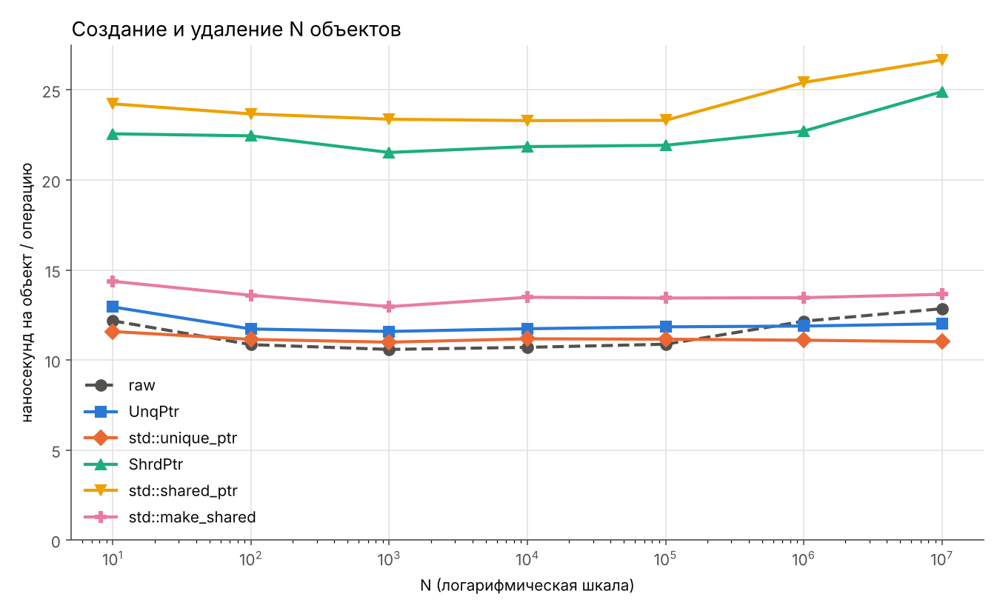
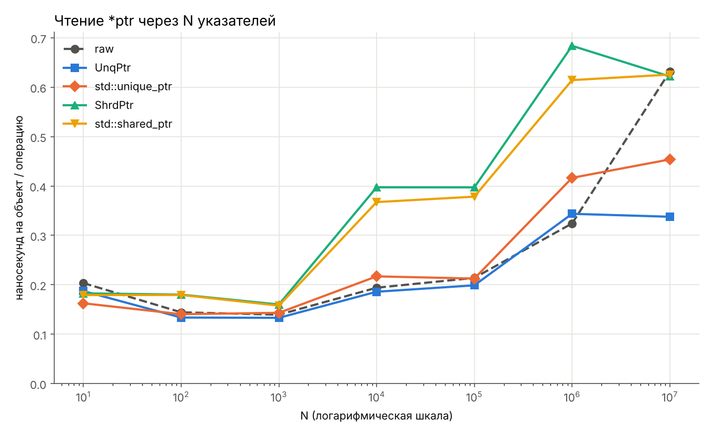
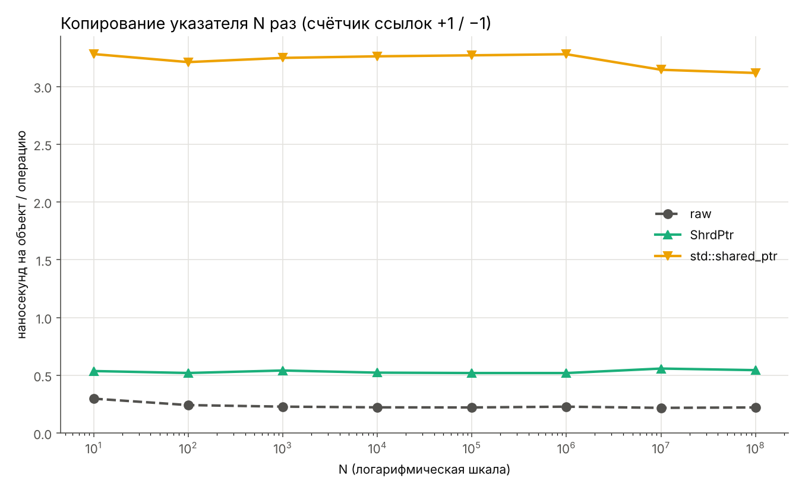
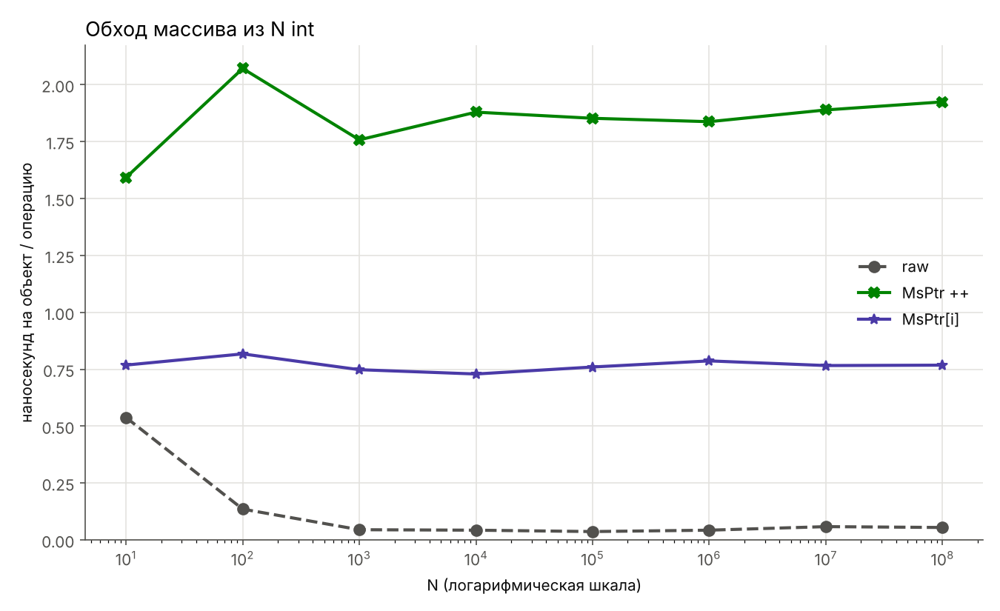
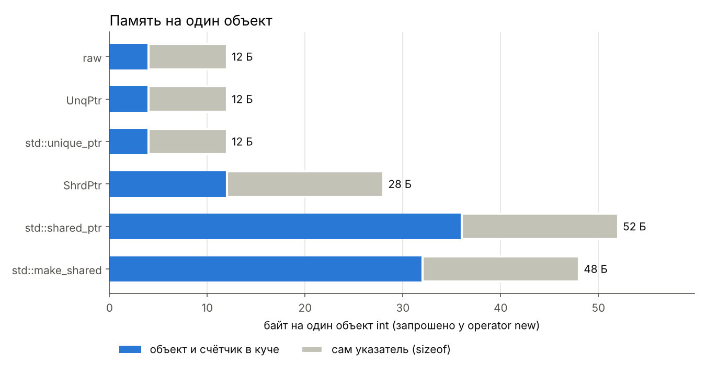
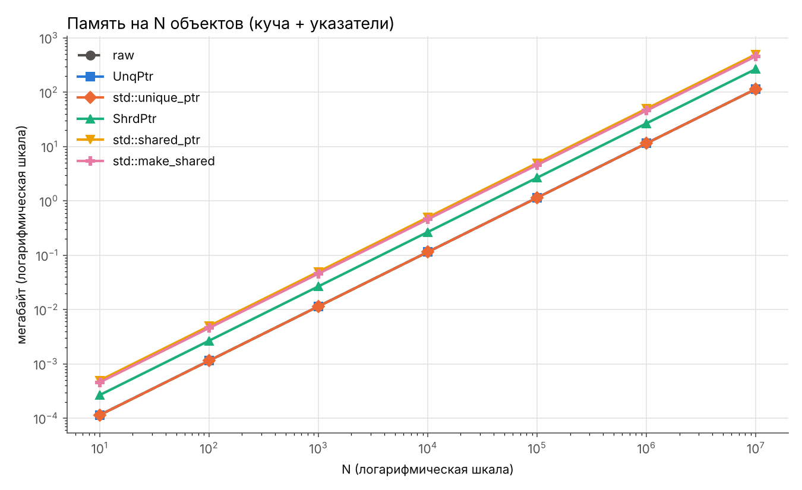

# Умные указатели (ДЗ-1)

Курс «Информатика (организация и поиск данных)», 3 семестр.

Реализованы шаблонные умные указатели **UnqPtr**, **ShrdPtr**, **MsPtr** и контейнер **MemorySpan**
без использования STL-реализаций (`std::unique_ptr`/`std::shared_ptr` подключаются только в бенчмарках для сравнения).
Вариант задания: децентрализованное хранение, вариант 2 (счётчик ссылок `size_t* ref_count_` только в ShrdPtr)
плюс арифметика указателей (MemorySpan + MsPtr).

## Что реализовано

| Класс | Назначение | Особенности |
|---|---|---|
| `UnqPtr<T>`, `UnqPtr<T[]>` | единоличное владение объектом / массивом | копирование запрещено, только перемещение; `Release`, `Reset`, `Swap`, `MakeUnq<T>(...)`, `MakeUnq<T[]>(n)`; размер равен размеру сырого указателя |
| `ShrdPtr<T>`, `ShrdPtr<T[]>` | разделяемое владение, счётчик ссылок | общий счётчик `size_t*` в куче; объект удаляется последним владельцем; создаётся из `UnqPtr&&`, сырого указателя или `MakeShrd` |
| `MemorySpan<T>` | массив фиксированного размера | элементы доступны только через умные указатели: `Get(i)` → `UnqPtr<T>`, `Copy(i)` → `ShrdPtr<T>`, `Locate(i)` → `MsPtr<T>` |
| `MsPtr<T>` | указатель с арифметикой внутри MemorySpan | `++ -- += -= + - [] * ->`, сравнения, расстояние; выход за границы бросает `std::out_of_range` |
| `DynamicArray<T>`, `MutableArraySequence<T>` | контейнеры из ЛР-2 на умных указателях | буфером `DynamicArray` владеет `UnqPtr<T[]>`, своего `delete[]` нет; `ArraySequence` построен поверх `DynamicArray` |

Удаление объекта в ShrdPtr не дублирует код: когда счётчик доходит до нуля, объект передаётся
временному `UnqPtr<T>`, и удаляет его деструктор UnqPtr.

### Подтипизация

Если `Derived` — открытый наследник `Base`, то работает:

```cpp
UnqPtr<Base>  a = MakeUnq<Derived>();
ShrdPtr<Base> b = MakeShrd<Derived>();
ShrdPtr<Base> c = b;               // общий счётчик
UnqPtr<const int> d = MakeUnq<int>(1);
```

Не компилируются (ограничения через концепты в `requires`):

* downcast `Base → Derived` и преобразование между несвязанными типами;
* закрытое наследование;
* upcast к базовому классу **без виртуального деструктора** (иначе `delete` через `Base*` — UB) — и при перемещении,
  и при создании из сырого указателя, и в `Reset`;
* любые преобразования для массивов `UnqPtr<T[]>` и `ShrdPtr<T[]>` — у них подтипизации нет совсем
  (ни `Derived[] → Base[]`, ни `T[] → const T[]`), принимается только `T*`. Для `Derived*` в `UnqPtr<Base[]>`
  это особенно важно: шаг массива равен `sizeof(Derived)`, а индексация через `Base*` шла бы с шагом `sizeof(Base)`.
  Такой вызов попадает в удалённый (`= delete`) шаблонный конструктор и не компилируется.

Все эти случаи проверены `static_assert` в тестах.

## Структура проекта

```
include/pointers/   UnqPtr.hpp, ShrdPtr.hpp, MsPtr.hpp, MemorySpan.hpp
include/lab2/       контейнеры из ЛР-2: DynamicArray (на UnqPtr<T[]>), Sequence, ArraySequence, ListSequence;
                    используются в тестах и в бенчмарках вместо std::vector
src/main.cpp        консольное меню
tests/              функциональные тесты (GoogleTest)
benchmarks/         нагрузочные тесты и plot.py для графиков
benchmark_results/  results.csv и графики
```

## Сборка и запуск

Нужны CMake ≥ 3.20 и компилятор с C++20. GoogleTest скачивается автоматически.

```bash
cmake -S . -B build
cmake --build build

./build/smart_pointers_app        # меню
./build/unit_tests                # тесты
./build/alloc_failure_tests       # тесты при нехватке памяти (bad_alloc)
./build/benchmarks                # нагрузочные тесты, около минуты (--quick - пара секунд)
python3 benchmarks/plot.py benchmark_results/results.csv   # графики
```

Сборка с санитайзерами: `cmake -S . -B build-asan -DENABLE_ASAN=ON`.

## Функциональные тесты

169 тестов: `UnqPtr`, `UnqPtr<T[]>`, `ShrdPtr`, `ShrdPtr<T[]>`, `MsPtr`, `MemorySpan`, `DynamicArray`,
`MutableArraySequence`/`ImmutableArraySequence` (контейнеры ЛР-2 на `UnqPtr<T[]>`), плюс death-тесты
(разыменование пустого указателя ловит `assert`) и отдельная программа `alloc_failure_tests`, где `operator new`
подменён так, чтобы бросить `std::bad_alloc` при выделении счётчика ShrdPtr: объект при этом не теряется и не удаляется дважды.

Отсутствие утечек и двойных удалений внутри тестов проверяет `InstanceTracker` — счётчик живых объектов
(++ в конструкторах, -- в деструкторе), после каждого теста он должен быть равен 0.

## Проверка утечек

**Valgrind** (Ubuntu 24.04, g++ 13, Debug):

```
$ valgrind --leak-check=full ./build/unit_tests --gtest_filter='-*DeathTest*'
[  PASSED  ] 160 tests.
==1338== HEAP SUMMARY:
==1338==     in use at exit: 0 bytes in 0 blocks
==1338==   total heap usage: 3,216 allocs, 3,216 frees, 372,078 bytes allocated
==1338== All heap blocks were freed -- no leaks are possible
==1338== ERROR SUMMARY: 0 errors from 0 contexts (suppressed: 0 from 0)
```

Death-тесты исключены, потому что они запускают дочерний процесс, который намеренно падает на `assert`.
Консольное меню под Valgrind тоже даёт `All heap blocks were freed`.

**AddressSanitizer + UBSan** (`-DENABLE_ASAN=ON`): все тесты проходят без ошибок.

## Нагрузочное тестирование

Машина: MacBook Pro (Apple M5), Apple Clang, `-O2 -DNDEBUG`.
Время — наносекунды на один объект (одну операцию). Для маленьких N прогон повторяется,
пока не наберётся ~2 млн операций, и время делится на число повторов. Перед замерами есть разогревочный прогон.
Память считается заменённым глобальным `operator new` (`benchmarks/AllocationCounter.cpp`).

Сценарии:

* **create** — создать N объектов `int` (каждый — отдельный `new`) и удалить их;
* **access** — прочитать `*ptr` через N указателей;
* **copy** — N раз скопировать указатель и уничтожить копию (для ShrdPtr это +1 и −1 к счётчику);
* **traverse** — пройти массив из N `int`: сырой указатель против MsPtr (каждый шаг проверяет границы).

### create, нс на объект

| N | raw | UnqPtr | std::unique_ptr | ShrdPtr | std::shared_ptr | std::make_shared |
|---:|---:|---:|---:|---:|---:|---:|
| 10 | 12.18 | 12.95 | 11.58 | 22.56 | 24.23 | 14.37 |
| 100 | 10.85 | 11.72 | 11.15 | 22.45 | 23.67 | 13.60 |
| 1 000 | 10.59 | 11.59 | 10.99 | 21.53 | 23.38 | 12.96 |
| 10 000 | 10.70 | 11.74 | 11.18 | 21.86 | 23.30 | 13.48 |
| 100 000 | 10.88 | 11.84 | 11.16 | 21.93 | 23.31 | 13.44 |
| 1 000 000 | 12.15 | 11.89 | 11.10 | 22.72 | 25.42 | 13.46 |
| 10 000 000 | 12.85 | 12.01 | 11.02 | 24.91 | 26.67 | 13.65 |



### access, нс на чтение

| N | raw | UnqPtr | std::unique_ptr | ShrdPtr | std::shared_ptr |
|---:|---:|---:|---:|---:|---:|
| 10 | 0.20 | 0.19 | 0.16 | 0.18 | 0.18 |
| 100 | 0.14 | 0.13 | 0.14 | 0.18 | 0.18 |
| 1 000 | 0.14 | 0.13 | 0.14 | 0.16 | 0.16 |
| 10 000 | 0.19 | 0.19 | 0.22 | 0.40 | 0.37 |
| 100 000 | 0.21 | 0.20 | 0.21 | 0.40 | 0.38 |
| 1 000 000 | 0.32 | 0.34 | 0.42 | 0.68 | 0.61 |
| 10 000 000 | 0.63 | 0.34 | 0.45 | 0.62 | 0.63 |



### copy, нс на копирование

| N | raw | ShrdPtr | std::shared_ptr |
|---:|---:|---:|---:|
| 10 | 0.30 | 0.54 | 3.28 |
| 100 | 0.24 | 0.52 | 3.21 |
| 1 000 | 0.23 | 0.54 | 3.25 |
| 10 000 | 0.22 | 0.52 | 3.26 |
| 100 000 | 0.22 | 0.52 | 3.27 |
| 1 000 000 | 0.23 | 0.52 | 3.28 |
| 10 000 000 | 0.22 | 0.56 | 3.14 |
| 100 000 000 | 0.22 | 0.54 | 3.12 |



### traverse, нс на элемент

| N | raw | MsPtr ++ | MsPtr[i] |
|---:|---:|---:|---:|
| 10 | 0.54 | 1.59 | 0.77 |
| 100 | 0.14 | 2.07 | 0.82 |
| 1 000 | 0.05 | 1.76 | 0.75 |
| 10 000 | 0.04 | 1.88 | 0.73 |
| 100 000 | 0.04 | 1.85 | 0.76 |
| 1 000 000 | 0.04 | 1.84 | 0.79 |
| 10 000 000 | 0.06 | 1.89 | 0.77 |
| 100 000 000 | 0.06 | 1.92 | 0.77 |



### Память на один объект `int` (N = 10⁷)

| Вариант | Выделений на объект | Байт в куче | Байт на сам указатель | Всего |
|---|---:|---:|---:|---:|
| raw | 1 | 4 | 8 | 12 |
| UnqPtr | 1 | 4 | 8 | 12 |
| std::unique_ptr | 1 | 4 | 8 | 12 |
| ShrdPtr | 2 | 12 (4 объект + 8 счётчик) | 16 | 28 |
| std::shared_ptr(new T) | 2 | 36 (4 объект + 32 control block) | 16 | 52 |
| std::make_shared | 1 | 32 (объект внутри control block) | 16 | 48 |





Это байты, запрошенные у `operator new`. Реально занято больше: `malloc` округляет каждый блок
(минимум 16 байт), поэтому два выделения у ShrdPtr на практике дороже, чем одно у `make_shared`.

### Выводы

* **UnqPtr ничего не стоит**: по времени и памяти он совпадает с сырым указателем и `std::unique_ptr`
  (внутри один указатель, все методы встраиваются компилятором).
* **ShrdPtr создаётся примерно в 2 раза дольше** UnqPtr, потому что делает два выделения памяти (объект + счётчик).
  Так же ведёт себя `std::shared_ptr(new T)`; `std::make_shared` кладёт объект и счётчик в один блок
  и поэтому заметно быстрее (≈13.5 нс против ≈22 нс), почти как UnqPtr.
* **Копирование ShrdPtr в ~6 раз быстрее std::shared_ptr**: у нас счётчик — обычный `size_t`,
  а в `std::shared_ptr` он атомарный (потокобезопасный). Обратная сторона: ShrdPtr нельзя
  копировать из разных потоков одновременно.
* **По памяти ShrdPtr экономнее std::shared_ptr** (12 против 32–36 байт в куче): у нас нет weak-счётчика, делитера
  и таблицы виртуальных функций control block.
* **Чтение** через все указатели одинаково; рост на больших N вызван промахами кэша (объекты разбросаны по куче),
  а не указателями. У ShrdPtr и shared_ptr указатель 16 байт, массив указателей вдвое больше — отсюда разница при N ≥ 10⁴.
* **MsPtr медленнее сырого указателя** (≈0.8–1.9 нс против 0.05 нс на элемент): каждый шаг проверяет границы,
  и компилятор не может векторизовать цикл. Это цена безопасности: выход за границы бросает исключение,
  а не портит память. Индексация `begin[i]` быстрее, чем `++ptr`, потому что `++` проверяет границы дважды
  (при сдвиге и при разыменовании).

## Ограничения

* Счётчик ShrdPtr не атомарный — указатель не потокобезопасен.
* Циклические ссылки ShrdPtr не освобождаются (weak-указателя нет; это показано в тесте `CycleKeepsObjectsAliveUntilBroken`).
* MsPtr хранит адрес своего MemorySpan: если MemorySpan уничтожен, MsPtr становится висячим.
  После перемещения MemorySpan старые MsPtr видят пустой массив и бросают `out_of_range`.
* `MemorySpan::Get` и `Copy` возвращают умный указатель на **копию** элемента; изменить сам элемент можно через `Locate`.
